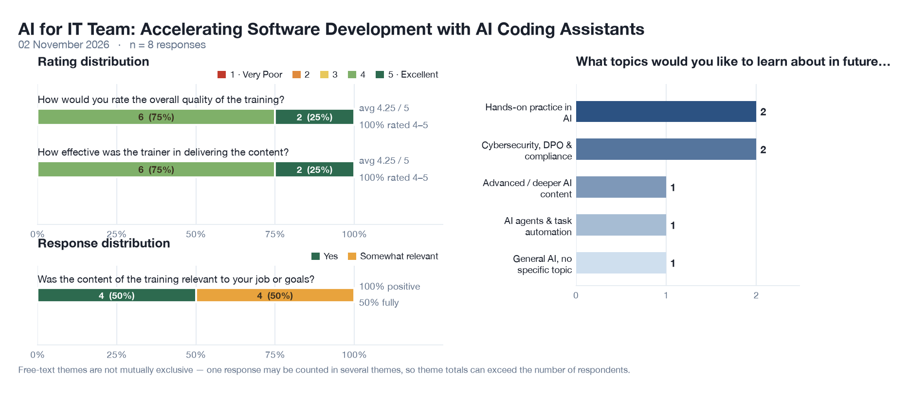

# AI for IT Team: Accelerating Software Development with AI Coding Assistants

**Training:** AI for IT Team: Accelerating Software Development with AI Coding Assistants  
**Client:** Amsteel  
**Date:** 02 November 2026  
**Responses collected:** 8  •  **Report date:** 03 November 2026

---

## Verdict

All eight respondents rated the training 4 or 5 and none scored it below 4, on both overall quality and trainer effectiveness (4.25 / 5 each). There is no dissatisfaction to answer. The finding that matters is narrower: six of the eight stopped at 4 rather than 5, and half the room called the content only "somewhat relevant" to their job. The training was delivered well and landed one step short of the participants' own work.

## 1. Overall quality of the training — 4.25 / 5

| Rating | 1 | 2 | 3 | 4 | 5 |
|--------|:-:|:-:|:-:|:-:|:-:|
| Count | 0 | 0 | 0 | 6 | 2 |

- Eight of eight scored 4 or 5 on a scale anchored 1 · Very Poor to 5 · Excellent; average 4.25.
- Six chose 4 and only two chose 5. A 4 is a solid session; a 5 is one the participant would insist a colleague attend. Nothing in the free text suggests a defect — the ceiling is headroom, not a complaint.

## 2. Most valuable aspect — tools, tips and hands-on work

| Theme | Mentions |
|-------|:---:|
| Tools, tips & techniques shared | 3 |
| Practical / hands-on activities | 2 |
| Real-life examples & case studies | 2 |
| Trainer's clarity & delivery | 1 |

All eight answered. Theme counts are not exclusive, but here each response named a single aspect, so the eight mentions map to eight participants.

- What participants valued is concrete: the tools and tips themselves (3), the practical work (2) and real-world examples (2). Together that is seven of eight pointing at applied material rather than theory.
- Only one response praised the trainer's style. Delivery earns a mention but is not what the room came for — the demonstrations and the hands-on segments carried the session.

### Verbatim

> "New AI info and tips"

> "Use case study"

> "Real life example"

> "Friendly and clear."

## 3. Relevance to job or goals — the weakest result

| Response | Count |
|----------|:---:|
| Yes | 4 |
| Somewhat relevant | 4 |
| No | 0 |

- Half the room — 4 of 8 — picked "Somewhat relevant" over "Yes". That is a soft negative, not a compliment: it says the participant followed the material but could not see their own job in it.
- Nobody answered "No", so this is a positioning gap rather than a credibility gap. The fix is not more content; it is running the same content against the participants' own repositories, tickets and review process.

## 4. Trainer effectiveness — 4.25 / 5

| Rating | 1 | 2 | 3 | 4 | 5 |
|--------|:-:|:-:|:-:|:-:|:-:|
| Count | 0 | 0 | 0 | 6 | 2 |

- Identical distribution to the quality score (6 × 4, 2 × 5; average 4.25), and the only delivery comment in the free text was "Friendly and clear."
- Delivery is not the constraint on this result. Any follow-up budget is better spent on tailoring the material to the team's toolchain than on trainer coaching.

## 5. What they want next

| Theme | Mentions |
|-------|:---:|
| Hands-on practice in AI | 2 |
| Cybersecurity, DPO & compliance | 2 |
| Advanced / deeper AI content | 1 |
| AI agents & task automation | 1 |
| General AI, no specific topic | 1 |

Seven of eight named a topic; one wrote only "AI", which carries no direction. As above, these are clustered requests rather than votes — read them as demand signals, not a ranking.

- The demand splits into two distinct asks: more supervised practice with the assistants (2), and the governance side of using them — cybersecurity and DPO obligations (2). A third cluster wants to go deeper or into agents and automation (1 each).
- Two of the eight asked for the same practical depth they had just been given. That reinforces the relevance finding: the appetite is for doing, not for more slides.

### Verbatim

> "More  hands on training in AI"

> "Cybersecurity and DPO related"

> "Deeper AI exposion"

> "Automate task"

## Key Takeaways & Recommendations

1. **The programme is safe to repeat.** Eight of eight rated it 4 or 5, with zero scores below 4, on both quality and trainer effectiveness. Run the same outline for the next Amsteel cohort without a redesign.
2. **The format is the asset.** Tools and tips (3 mentions), hands-on activities (2) and real-life examples (2) were named by seven of the eight respondents as the most valuable part of the day. Keep the demo-then-lab structure and protect it from being compressed; add a take-away prompt workbook so the exercises survive without live internet.
3. **Close the relevance gap before adding content.** Four of eight called the content only "somewhat relevant". Insert a 20-minute "your own ticket" segment: each participant brings a live ticket from their backlog, applies the assistant to it and reviews the diff with the room. That converts "somewhat" into "yes" using material already prepared.
4. **Run a two-part follow-up, not one longer course.** The future requests split cleanly: a 1-day *AI for Secure Development & Compliance* track (data handling, DPO and PDPA obligations, review gates for AI-written code) for the two who named cybersecurity, and a half-day advanced lab on agents and task automation (scripted refactors, CI integration) for the two who asked for deeper or agentic content — the second gated on the first.
5. **Treat n = 8 as directional.** One additional respondent moves any figure by 12.5 points, and the free-text themes are clustered requests from eight people, not a ranked ballot. Repeat the survey at the next cohort before committing budget to a track on the strength of a two-mention theme.

*Prepared from 8 raw feedback responses collected on 02 November 2026.*
